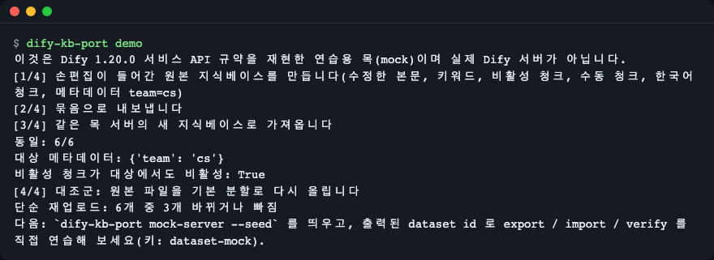
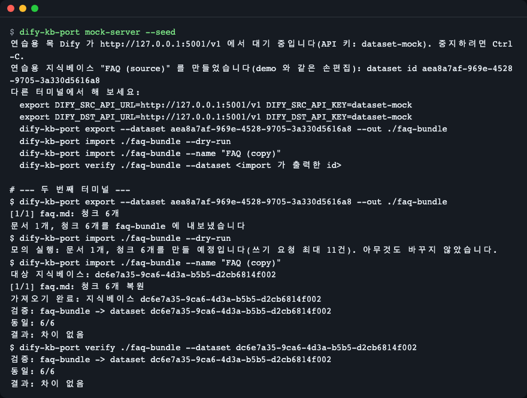
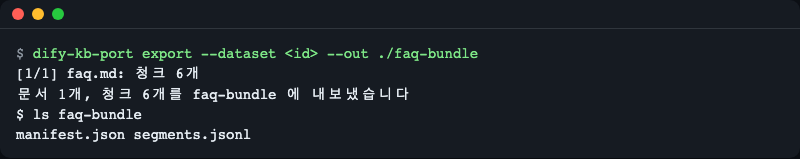
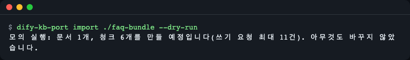
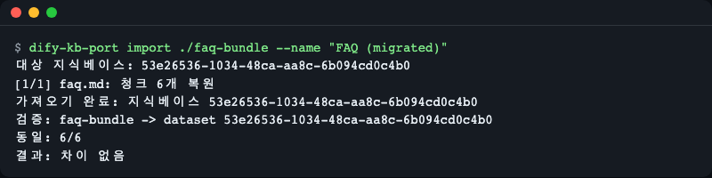
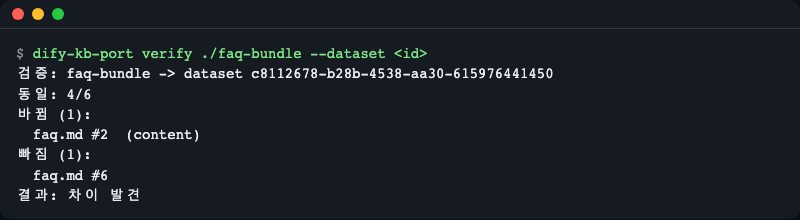
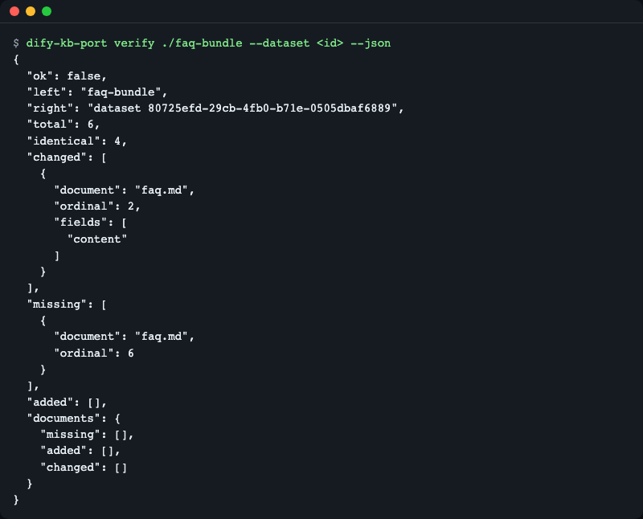
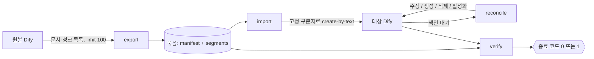

# dify-kb-port

[English](README.md) | **한국어**

공개 Knowledge API 와 Knowledge API 키만으로 Dify 지식베이스를 청크 단위까지 백업·이전·검증합니다. 손으로 고친 청크, Q&A 답변, 키워드, 비활성 청크, 메타데이터 값이 함께 옮겨지고, 해시 기반 `verify` 가 복사본이 같은지 증명합니다(종료 코드 0 또는 1, CI 에서 쓸 수 있습니다).


*연습용 목에서 실행한 `dify-kb-port demo`: 왕복 이전은 청크 6개가 모두 일치하고, 원본 파일을 기본 분할로 다시 올리면 6개 중 3개가 바뀌거나 사라집니다.*

> **상태: 실제 Dify 서버로는 아직 검증하지 않았습니다.** 모든 테스트와 데모는 Dify 1.20.0 Knowledge API 규약(페이지 상한, 비동기 색인, 429, 청크 재분할)을 재현한 연습용 목(mock)에서 돕니다. 목은 Dify 가 아닙니다. 운영 이전을 믿기 전에 실제 인스턴스에서 [docs/real-server-check.md](docs/real-server-check.md) 의 짧은 점검표를 한 번 돌려 보고, 차이가 있으면 이슈로 알려 주세요.

## 이런 분께
- Dify 를 직접 호스팅하면서 지식베이스를 스테이징에서 운영으로 올리거나 새 인스턴스로 옮기려는 분
- 콘솔에서 청크를 손으로 고쳤고, 원본 파일이 아니라 그 수정까지 남기는 백업이 필요한 분
- 지식베이스 복사본이 원본과 다르면 실패하는 CI 단계가 필요한 분

## 설치
Python 3.10 이상이 필요합니다. [uv](https://docs.astral.sh/uv/) 로 실행하는 것이 가장 쉽습니다(`curl -LsSf https://astral.sh/uv/install.sh | sh`). 추가 시스템 패키지는 필요 없습니다.

```bash
git clone https://github.com/LeeGyeongPil/dify-kb-port
cd dify-kb-port
uv run dify-kb-port --version
```
```
dify-kb-port 0.1.0
```
실행 의존성은 `httpx` 하나입니다.

## 빠르게 시작하기
서버나 키 없이 먼저 해 볼 수 있습니다. `demo` 는 내장 연습용 목을 띄우고, 손편집이 들어간 지식베이스를 만들어 내보낸 뒤 새 지식베이스로 가져와 둘을 비교합니다.

```bash
uv run dify-kb-port demo --lang ko
```
```
이것은 Dify 1.20.0 서비스 API 규약을 재현한 연습용 목(mock)이며 실제 Dify 서버가 아닙니다.
[1/4] 손편집이 들어간 원본 지식베이스를 만듭니다(수정한 본문, 키워드, 비활성 청크, 수동 청크, 한국어 청크, 메타데이터 team=cs)
[2/4] 묶음으로 내보냅니다
[3/4] 같은 목 서버의 새 지식베이스로 가져옵니다
동일: 6/6
대상 메타데이터: {'team': 'cs'}
비활성 청크가 대상에서도 비활성: True
[4/4] 대조군: 원본 파일을 기본 분할로 다시 올립니다
단순 재업로드: 6개 중 3개 바뀌거나 빠짐
다음: `dify-kb-port mock-server --seed` 를 띄우고, 출력된 dataset id 로 export / import / verify 를 직접 연습해 보세요(키: dataset-mock).
```
`--lang ko` 가 없어도 한국어 로캘이면 같은 한국어 출력이 나오고, 그렇지 않으면 영어로 나옵니다.

`동일: 6/6` 은 여섯 청크의 본문·답변·키워드·활성 상태가 복사본에서도 같다는 뜻입니다. 대조 줄도 실제로 계산한 값입니다. 원본 파일을 다시 올려서 달라진 청크 수를 셉니다. `demo` 는 끝나면 묶음을 지웁니다. 각 단계를 직접 해 보는 방법은 다음 절에 있습니다.

### 목 서버로 연습하기
실제 인스턴스를 건드리기 전에 진짜 명령으로 이전 전체를 리허설해 봅니다. 순서는 내보내기, 모의 실행, 가져오기, 검증입니다. `mock-server --seed` 는 연습용 목을 계속 띄워 두고, `demo` 와 같은 손편집 지식베이스를 만듭니다. 그다음 dataset id 와 붙여 넣을 명령을 출력합니다. `127.0.0.1` 에서만 대기합니다(기본 포트 `5001`, `--port` 로 바꿉니다). `--seed` 없이 띄우면 빈 상태로 시작합니다.

**터미널 1** - 목을 띄우고 그대로 둡니다.

```bash
uv run dify-kb-port mock-server --seed --lang ko
```
```
연습용 목 Dify 가 http://127.0.0.1:5001/v1 에서 대기 중입니다(API 키: dataset-mock). 중지하려면 Ctrl-C.
연습용 지식베이스 "FAQ (source)" 를 만들었습니다(demo 와 같은 손편집): dataset id b124e2e1-2da5-4206-8e92-7e9bcadb9498
다른 터미널에서 해 보세요:
  export DIFY_SRC_API_URL=http://127.0.0.1:5001/v1 DIFY_SRC_API_KEY=dataset-mock
  export DIFY_DST_API_URL=http://127.0.0.1:5001/v1 DIFY_DST_API_KEY=dataset-mock
  dify-kb-port export --dataset b124e2e1-2da5-4206-8e92-7e9bcadb9498 --out ./faq-bundle
  dify-kb-port import ./faq-bundle --dry-run
  dify-kb-port import ./faq-bundle --name "FAQ (copy)"
  dify-kb-port verify ./faq-bundle --dataset <import 가 출력한 id>
```
id 는 실행할 때마다 무작위로 바뀝니다. 자기 터미널에 나온 값을 복사하세요.

**터미널 2** - 같은 `dify-kb-port` 폴더에서 엽니다. 먼저 `export` 두 줄을 붙여 넣습니다. 원본(`SRC`)과 대상(`DST`)을 모두 목으로 향하게 하는 줄입니다. 그다음 출력된 명령을 앞에 `uv run` 을 붙여 실행합니다. 한국어 화면을 보려면 `export DIFY_KB_PORT_LANG=ko` 도 함께 입력하세요.

1. 만들어 둔 지식베이스를 묶음(일반 파일이 든 폴더)으로 내보냅니다.
   ```bash
   uv run dify-kb-port export --dataset b124e2e1-2da5-4206-8e92-7e9bcadb9498 --out ./faq-bundle
   ```
   ```
   [1/1] faq.md: 청크 6개
   문서 1개, 청크 6개를 faq-bundle 에 내보냈습니다
   ```
2. 모의 실행: 아무것도 쓰지 않고 가져오기가 무엇을 만들지 봅니다.
   ```bash
   uv run dify-kb-port import ./faq-bundle --dry-run
   ```
   ```
   모의 실행: 문서 1개, 청크 6개를 만들 예정입니다(쓰기 요청 최대 11건). 아무것도 바꾸지 않았습니다.
   ```
3. 새 지식베이스로 가져옵니다. `import` 는 결과를 스스로 검증합니다.
   ```bash
   uv run dify-kb-port import ./faq-bundle --name "FAQ (copy)"
   ```
   ```
   대상 지식베이스: 4f6f4389-896f-465d-9aa1-bb4eba02a013
   [1/1] faq.md: 청크 6개 복원
   가져오기 완료: 지식베이스 4f6f4389-896f-465d-9aa1-bb4eba02a013
   검증: faq-bundle -> dataset 4f6f4389-896f-465d-9aa1-bb4eba02a013
   동일: 6/6
   결과: 차이 없음
   ```
4. `import` 가 출력한 id 로 언제든 다시 검증합니다.
   ```bash
   uv run dify-kb-port verify ./faq-bundle --dataset 4f6f4389-896f-465d-9aa1-bb4eba02a013
   ```
   ```
   검증: faq-bundle -> dataset 4f6f4389-896f-465d-9aa1-bb4eba02a013
   동일: 6/6
   결과: 차이 없음
   ```

네 명령 모두 종료 코드 `0` 으로 끝납니다. 여기서는 원본과 대상이 같은 목이라서 `import` 가 첫 지식베이스 옆에 두 번째 지식베이스를 만듭니다.


*연습용 목에서 한 전체 리허설: 서버 출력, 그리고 두 번째 터미널에서 실행한 네 명령.*

서버가 떠 있는 동안 두 가지를 더 해 볼 수 있습니다.
- 묶음 없이 원본과 복사본을 바로 비교합니다. `diff` 는 두 쪽을 받습니다. `src:` 는 `DIFY_SRC_*` 에서, `dst:` 는 `DIFY_DST_*` 에서 읽습니다(아래 id 는 자리표시자로 줄였습니다).
  ```bash
  uv run dify-kb-port diff src:<원본 id> dst:<복사본 id>
  ```
  ```
  검증: src:<원본 id> -> dst:<복사본 id>
  동일: 6/6
  결과: 차이 없음
  ```
- `faq-bundle/segments.jsonl` 의 청크 하나를 손으로 고치고 4단계를 다시 실행합니다. 묶음은 문서마다 체크섬을 저장하므로 `verify` 는 고친 묶음을 비교하지 않고 종료 코드 `2` 로 거부합니다.
  ```
  오류: 문서 'faq.md' 의 체크섬이 맞지 않습니다. 묶음이 수정됐거나 손상됐으니 다시 내보내세요.
  ```

다 했으면 터미널 1 에서 Ctrl-C 를 누릅니다. 서버는 `중지됨` 을 출력합니다. 목은 모든 것을 메모리에만 두므로 다음에 띄우면 새 id 로 처음부터 시작합니다. `./faq-bundle` 폴더는 디스크에 남습니다. `export` 는 비어 있지 않은 폴더를 거부하니 다시 내보내기 전에 지우세요.
```
오류: faq-bundle 가 이미 있고 비어 있지 않습니다. 다른 --out 을 쓰거나 --force 를 주세요.
```

이것은 연습용 목이며 Dify 가 아닙니다. 명령과 묶음을 확인할 뿐, 실제 서버를 확인하지는 않습니다.

## 사용법
접속 정보는 환경변수로 받습니다([설정](#설정) 참고). 키는 묶음 파일에 쓰이지 않습니다.

| 명령 | 하는 일 | 예 |
|---|---|---|
| `export` | 원본 인스턴스의 지식베이스를 묶음 디렉터리로 읽어 옵니다 | `dify-kb-port export --dataset <id> --out ./faq-bundle` |
| `import` | 대상에 지식베이스를 청크 단위로 만들고 검증합니다 | `dify-kb-port import ./faq-bundle --name "FAQ (migrated)"` |
| `import --dry-run` | 대상을 점검하고 개수만 보고합니다. 쓰기 요청은 보내지 않습니다 | `dify-kb-port import ./faq-bundle --dry-run` |
| `import --resume` | 중단된 가져오기를 체크포인트에서 이어 합니다 | `dify-kb-port import ./faq-bundle --resume` |
| `import --into <id>` | 이미 있는 지식베이스에 가져옵니다(같은 이름 문서는 `--on-conflict skip\|replace`) | `dify-kb-port import ./faq-bundle --into <id>` |
| `verify` | 묶음과 대상의 지식베이스를 비교합니다 | `dify-kb-port verify ./faq-bundle --dataset <id>` |
| `diff` | 두 쪽을 비교합니다(묶음 경로, `src:<id>`, `dst:<id>`) | `dify-kb-port diff src:<id> dst:<id>` |
| `demo` | 키 없이 연습용 목에서 왕복 이전 | `dify-kb-port demo` |
| `mock-server --seed` | 연습용 지식베이스를 만든 연습용 목을 계속 띄워 리허설에 씁니다 | `dify-kb-port mock-server --seed --port 5001` |
| `--lang en\|ko` | 출력 언어(`DIFY_KB_PORT_LANG` 도 됩니다) | `dify-kb-port --lang ko demo` |

종료 코드: `0` 동일·정상, `1` 차이 발견, `2` 사용법·인증 오류, `3` API·색인 실패.

아래 화면은 실제 CLI 를 연습용 목에 돌린 것이라 지식베이스 id 는 매번 다릅니다.

### 1. 내보내기
```bash
export DIFY_SRC_API_URL=http://localhost/v1
export DIFY_SRC_API_KEY=dataset-xxxxxxxx
dify-kb-port export --dataset <id> --out ./faq-bundle
```

*묶음은 `manifest.json` 과 `segments.jsonl` 이 든 디렉터리입니다. 형식: [docs/bundle-format.md](docs/bundle-format.md).*

묶음에는 청크마다 한 줄이 들어갑니다. 서명된 파일 URL 과 id 는 저장하지 않습니다.

### 2. 드라이런, 그다음 가져오기
```bash
export DIFY_DST_API_URL=http://localhost/v1
export DIFY_DST_API_KEY=dataset-yyyyyyyy
dify-kb-port import ./faq-bundle --dry-run
dify-kb-port import ./faq-bundle --name "FAQ (migrated)"
```

*`--dry-run` 은 만들 내용을 보고만 하고 쓰기 요청을 보내지 않습니다.*


*`import` 는 청크를 복원하고, 색인이 끝나기를 기다린 뒤 스스로 `verify` 까지 합니다.*

대상은 본문을 자기 임베딩 모델로 다시 임베딩하므로 대상에 임베딩 모델이 설정돼 있어야 합니다. 임베딩은 복사하지 않습니다.

### 3. 검증과 비교
```bash
dify-kb-port verify ./faq-bundle --dataset <id>
```
아래는 가져온 뒤 대상에서 청크 하나를 고치고 마지막 청크를 지운 경우입니다.


*청크는 (문서 이름, 순번)으로 짝을 짓습니다. 종료 코드는 1 입니다.*

기계가 읽게 하려면 `--json` 을 붙입니다.


*`changed`, `missing`, `added` 가 문서 이름과 순번으로 차이를 나열합니다.*

순번으로 비교하므로 문서 중간의 청크를 지우면 뒤 청크가 모두 "바뀜"으로 나옵니다. 의도한 동작입니다.

### 4. 이미 있는 지식베이스에 가져오기
`--into <id>` 는 묶음의 문서를 이미 있는 지식베이스에 더합니다. 이름이 같은 문서는 기본으로 건너뛰고(`--on-conflict skip`), `--on-conflict replace` 를 주면 덮어씁니다. 건너뛴 문서도 묶음과 따로 비교하므로 다르면 알려 줍니다. 아래는 대상에 이미 `faq.md` 가 있고 청크 하나가 고쳐져 있던 경우입니다.

```bash
dify-kb-port import ./faq-bundle --into <id>
```
```
대상 지식베이스: <id>
[1/1] faq.md: 대상에 이미 있어 건너뜀(--on-conflict skip)
가져오기 완료: 지식베이스 <id>
가져온 문서가 없습니다: 모든 문서를 건너뛰어 이번 가져오기로 검증한 것이 없습니다.
경고: 건너뛴 문서 1개가 묶음과 다르며 그대로 두었습니다: faq.md. 차이는 `dify-kb-port verify` 로 보고, 덮어쓰려면 --on-conflict replace 로 다시 가져오세요.
```
건너뛰기는 사용자가 고른 동작이라 종료 코드는 `0` 입니다. 종료 코드는 이번에 가져온 문서로만 정해집니다. CI 에서 기존 문서까지 같아야 한다면 가져온 뒤 `verify` 를 실행하세요.

### 5. 실패 후 이어하기
요청이 중간에 실패하면(예: 문서 3개 중 두 번째에서 HTTP 500) 가져오기는 종료 코드 `3` 으로 끝나고 `<묶음>/.import-state.json` 에 체크포인트를 남깁니다. 같은 명령에 `--resume` 을 붙여 다시 실행하면 이미 만든 문서는 다시 만들지 않습니다. `--resume` 없이 체크포인트가 있으면 종료 코드 `2` 와 함께 안내가 나옵니다. 테스트 `tests/test_resume.py::test_resume_after_failure` 가 이를 확인합니다.

## 설정
[.env.example](.env.example) 을 참고하거나 변수를 직접 export 하세요.

| 변수 | 뜻 |
|---|---|
| `DIFY_SRC_API_URL` / `DIFY_SRC_API_KEY` | 원본 서비스 API 기본 URL(예: `http://localhost/v1`)과 Knowledge API 키(`dataset-...`) |
| `DIFY_DST_API_URL` / `DIFY_DST_API_KEY` | 대상의 같은 값 |
| `DIFY_KB_PORT_LANG` | `en` 또는 `ko`. 우선순위: `--lang`, 이 변수, `LC_ALL`, `LC_MESSAGES`, `LANG` 순이며 한국어가 아니면 영어 |

연습용 목과 실제 모드의 차이: `demo` 와 테스트는 키 없이 목에서 몇 초 만에 끝납니다. 실제 인스턴스는 임베딩 모델과 워커에 따라 색인 시간이 달라지고(문서마다 `--index-timeout` 까지 기다립니다, 기본 600초), 공유 클라우드는 HTTP 429 로 답할 수 있습니다(기다렸다가 다시 시도합니다).

키는 환경변수로만 읽으며 묶음이나 체크포인트에는 쓰지 않습니다.

## 동작 원리

- **export** 는 모든 문서와 청크를 페이지 단위로 읽고 id 로 중복을 없앤 뒤 묶음으로 씁니다. 서버가 페이지 수를 잘못 세어도 깔끔하게 끝납니다.
- **import** 는 청크를 고유 구분자로 이어 붙여 사용자 지정 규칙으로 `create-by-text` 를 호출하므로 서버가 우리가 자른 곳에서 그대로 쪼갭니다.
- **reconcile** 은 색인이 끝나면 서버가 만든 결과를 묶음과 순번으로 비교해 고칩니다. 본문 수정, 청크 생성·삭제, Q&A 답변·키워드·활성 상태 복원을 합니다. 서버가 긴 청크를 다시 쪼개도 여기서 바로잡힙니다.
- **verify** 는 청크마다 SHA-256 해시(본문, 답변, 정렬한 키워드, 활성 상태, 자식 청크)를 만들어 (문서 이름, 순번)으로 비교합니다. 문서 단위의 활성·보관·메타데이터 값은 따로 비교합니다.

## 호환성과 한계
- **규약**: Dify 1.20.0 Knowledge API 에 맞춰 만들었습니다. 연습용 목에서만 확인했고, 실제 인스턴스에서는 [docs/real-server-check.md](docs/real-server-check.md) 점검표로 확인합니다.
- **가져올 수 있는 문서 형식**: `text_model` 과 `qa_model`. `hierarchical_model`(부모-자식) 문서는 내보내기와 해시 비교는 되지만 **가져오기에서는 경고와 함께 건너뜁니다**. 가져오기 지원은 이후 버전에서 추가할 예정입니다. `qa_model` 가져오기는 문서를 만들 때 대상이 질문/답변 한 쌍을 생성하므로 대상에 시스템 모델이 설정돼 있어야 합니다.
- **범위 밖**: KnowledgeFS, RAG 파이프라인, 외부 지식베이스(공개 Knowledge API 로 옮길 수 없습니다)와 임베딩(대상이 자기 모델로 다시 임베딩합니다).
- **복사하지 않는 설정**: 검색 설정(`retrieval_model`)과 임베딩 모델 선택은 대상에 적용되지 않습니다. 대상 콘솔에서 직접 설정하세요.
- **짝짓기**: 청크는 (문서 이름, 순번)으로 짝을 짓습니다. 이름이 같은 문서가 둘이면 목록 순서대로 두 번째 문서에 ` (2)` 가 붙어 묶음에 저장됩니다.
- **요청 제한**: HTTP 429(예: Dify Cloud)는 기다렸다가 다시 시도합니다. 내보내기는 한 번에 100개씩 페이지로 읽습니다.
- **다시 올리거나 데이터베이스를 복사하면 안 되나요?** 데모에서 원본 파일을 기본 분할로 다시 올렸더니 6개 중 3개가 바뀌거나 빠졌습니다. 손편집, 답변, 키워드, 비활성 청크는 파일에 들어 있지 않기 때문입니다. 데이터베이스 복사는 두 서버의 저장소에 접근해야 하고 버전도 맞아야 하지만, 이 도구는 Knowledge API 키만 있으면 됩니다.

## 보안
- API 키는 환경변수로만 읽습니다. 묶음, 체크포인트, 오류 메시지에 쓰이지 않습니다.
- 묶음에는 서명된 파일 URL 과 id 가 들어가지 않고, 원본 URL 은 자격 증명·쿼리·프래그먼트를 뺀 채 저장됩니다.
- `.env` 는 git 에서 제외되고, [.env.example](.env.example) 에는 자리표시자만 있습니다.
- `mock-server` 와 `demo` 는 `127.0.0.1` 에서만 대기합니다.
- 묶음에는 지식베이스 본문이 일반 파일로 들어 있으니 원본 데이터처럼 보관하세요.
- 취약점은 [SECURITY.md](SECURITY.md) 안내대로 비공개로 알려 주세요.

## 언제 쓰나
- 잘 맞는 상황: Dify 인스턴스 사이에서 지식베이스를 옮기거나 올릴 때, 청크 수정이 보존되는 복원 가능한 백업을 둘 때, CI 에서 복사본이 같은지 증명할 때.
- 다른 도구: 앱이나 워크플로 전체를 복사하려면 콘솔의 Dify 앱 내보내기를 보세요([Dify 문서](https://docs.dify.ai/)). 데이터베이스까지 통째로 복사하려면 Dify 셀프호스팅 문서에 나온 방식으로 인스턴스를 백업하세요. 각 기능 범위는 그 문서에서 확인하세요.
- 0.1.0 의 범위 밖: 공개 Knowledge API 로 읽거나 쓸 수 없는 것, 그리고 임베딩(대상이 자기 것을 만듭니다).

## 자주 겪는 문제
| 증상 | 원인 | 해결 |
|---|---|---|
| 종료 코드 `2`, 인증 관련 메시지 | 키가 틀렸거나 Knowledge API 키(`dataset-...`)가 아님 | Dify 콘솔에서 Knowledge API 키를 만들고 URL 이 `/v1` 로 끝나는지 확인 |
| 가져오기에서 종료 코드 `2`, 체크포인트 언급 | 이전 가져오기가 중단됨 | `--resume` 으로 다시 실행하거나 `<묶음>/.import-state.json` 을 지워 처음부터 |
| 종료 코드 `3`, 색인 시간 초과 | 대상이 느리거나 임베딩 모델이 없음 | 대상에 임베딩 모델을 설정하거나 `--index-timeout` 을 늘림 |
| 문서 중간 청크를 지운 뒤 `verify` 에 바뀐 청크가 많음 | 청크를 순번으로 짝지음 | 의도된 동작. 빠진 청크를 고친 뒤 다시 비교 |
| 종료 코드 `2`, "JSON 이 아니라는" URL 관련 메시지 | API URL 이 서비스 API 가 아니라 웹 화면을 가리킴 | `/v1` 로 끝나는 서비스 API 기본 URL 을 쓰세요 |
| `import` 가 문서를 건너뛴다는 경고를 냄 | 이 버전이 가져올 수 없는 문서 형식(`hierarchical_model`) | 대상에서 그 문서를 직접 다시 만드세요. [호환성과 한계](#호환성과-한계) 참고 |
| 7초쯤 뒤 종료 코드 `3`, `http://.../v1 에 연결할 수 없습니다(... Connection refused)` | 서버가 꺼져 있거나 `DIFY_SRC_API_URL` / `DIFY_DST_API_URL` 이 다른 호스트·포트를 가리킴 | 서버를 켜고(연습이라면 `mock-server --seed`) URL 을 확인하세요. 연결 거부는 3번 다시 시도한 뒤 멈춥니다 |
| `import --into` 가 `가져온 문서가 없습니다` 와 건너뛴 문서가 다르다는 경고를 냄 | 대상에 같은 이름 문서가 이미 있고 기본값이 `--on-conflict skip` | `verify` 로 차이를 보거나 `--on-conflict replace` 로 다시 가져오세요 |
| `export` 가 종료 코드 `2`, `이미 있고 비어 있지 않습니다` | 예전 내보내기의 `--out` 폴더가 남아 있음 | 폴더를 지우거나 다른 `--out` 을 쓰거나 `--force` 를 주세요 |
| `verify` 가 종료 코드 `2`, `체크섬이 맞지 않습니다` | 내보낸 뒤 묶음 파일이 수정되거나 손상됨 | 다시 내보내세요. 묶음 파일은 손으로 고치지 마세요 |
| `mock-server` 가 종료 코드 `2`, `포트 5001 에서 대기할 수 없습니다` | 다른 프로그램이 그 포트를 씀 | `--port 5077` 처럼 다른 포트를 고르고, 출력된 URL 을 쓰세요 |

## 개발·기여
```bash
uv run pytest -q
```
```
........................................................................ [ 72%]
............................                                             [100%]
100 passed in 7.57s
```
버그·제안은 이슈로 남겨 주세요. 변경 기록은 [CHANGELOG.md](CHANGELOG.md).

## 라이선스
MIT. [LICENSE](LICENSE) 참고.
