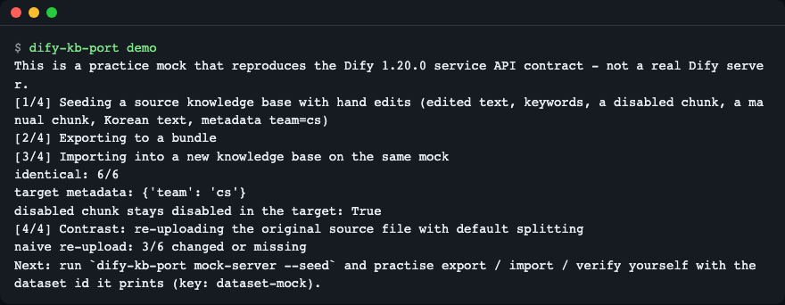
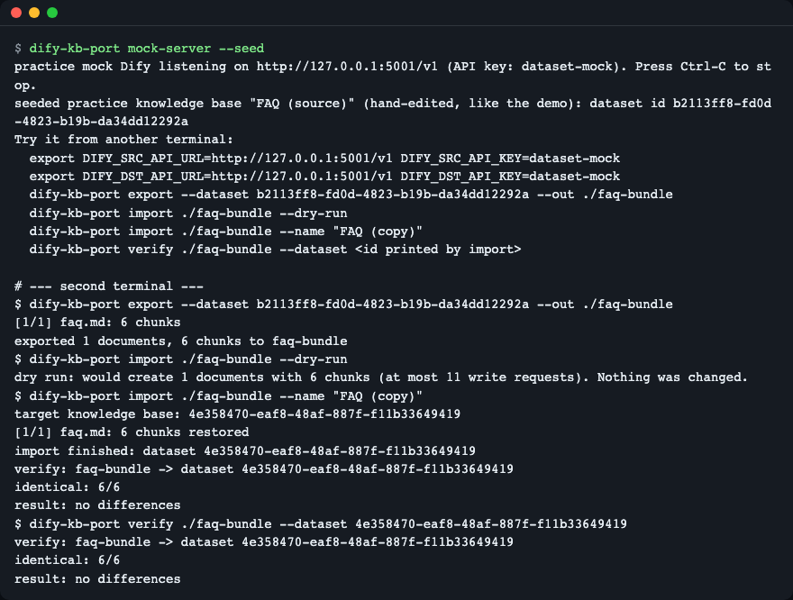
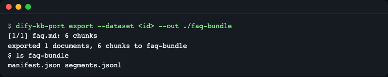
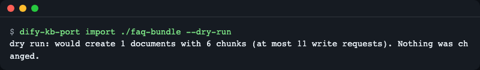
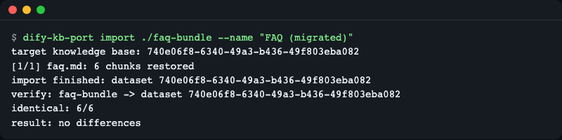
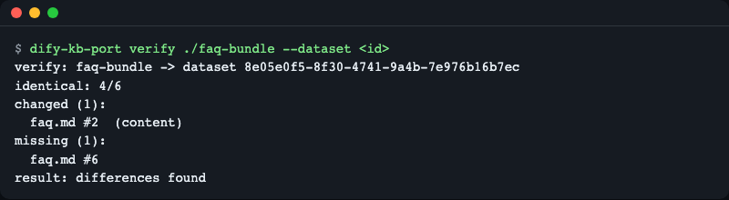
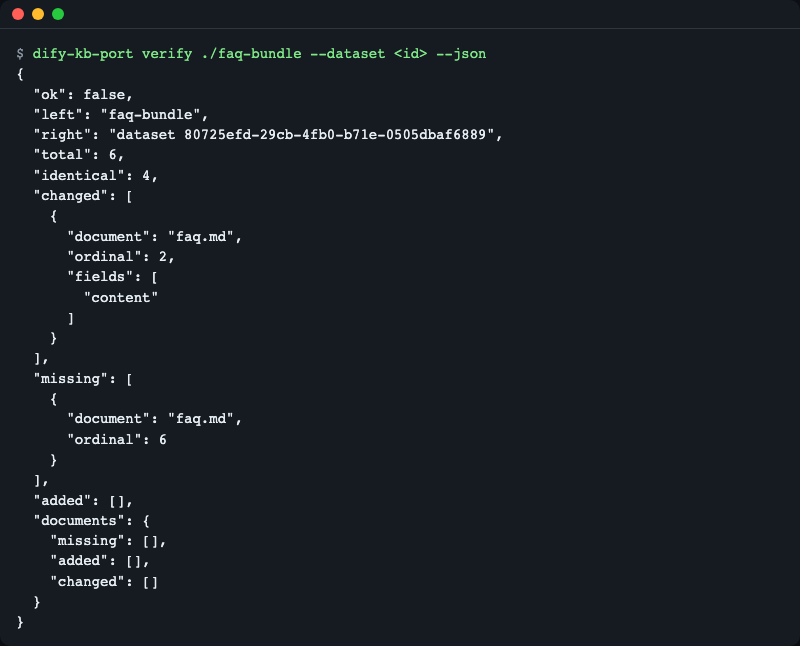
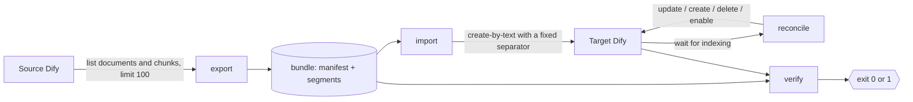

# dify-kb-port

**English** | [한국어](README.ko.md)

Back up, move and verify a Dify knowledge base chunk-for-chunk, using only the public Knowledge API and a Knowledge API key. Hand-edited chunks, Q&A answers, keywords, disabled chunks and metadata values come along, and a hash-based `verify` proves the copy matches (exit code 0 or 1, so CI can use it).


*`dify-kb-port demo` on the practice mock: the round trip matches 6/6 chunks, while re-uploading the source file with default splitting changes or loses 3 of 6.*

> **Status: not yet checked against a real Dify server.** All tests and the demo run against a bundled practice mock that reproduces the Dify 1.20.0 Knowledge API contract (pagination limits, asynchronous indexing, 429, chunk re-splitting). The mock is not Dify. Before trusting a production migration, run the short checklist in [docs/real-server-check.md](docs/real-server-check.md) once against a real instance, and report differences as an issue.

## Who it is for
- You self-host Dify and want to promote a knowledge base from staging to production, or move it to a new instance.
- You hand-edited chunks in the console and want a backup that keeps those edits, not just the original files.
- You want a CI step that fails when a copy of a knowledge base differs from the original.

## Install
Requires Python 3.10 or newer. [uv](https://docs.astral.sh/uv/) is the easiest way to run it (`curl -LsSf https://astral.sh/uv/install.sh | sh`). No extra system packages are needed.

```bash
git clone https://github.com/LeeGyeongPil/dify-kb-port
cd dify-kb-port
uv run dify-kb-port --version
```
```
dify-kb-port 0.1.0
```
The only runtime dependency is `httpx`.

## Quick start
Try it without any server or key. `demo` starts the bundled practice mock, seeds a knowledge base with hand edits, exports it, imports it into a new knowledge base and compares the two.

```bash
uv run dify-kb-port demo
```
```
This is a practice mock that reproduces the Dify 1.20.0 service API contract - not a real Dify server.
[1/4] Seeding a source knowledge base with hand edits (edited text, keywords, a disabled chunk, a manual chunk, Korean text, metadata team=cs)
[2/4] Exporting to a bundle
[3/4] Importing into a new knowledge base on the same mock
identical: 6/6
target metadata: {'team': 'cs'}
disabled chunk stays disabled in the target: True
[4/4] Contrast: re-uploading the original source file with default splitting
naive re-upload: 3/6 changed or missing
Next: run `dify-kb-port mock-server --seed` and practise export / import / verify yourself with the dataset id it prints (key: dataset-mock).
```
`identical: 6/6` means all six chunks have the same content, answer, keywords and enabled state in the copy. The contrast line is computed too: it re-uploads the original file and counts how many chunks differ. `demo` deletes its bundle when it ends; the next section shows how to run each step yourself.

### Practice with the mock server
Before you touch a real instance, rehearse the whole migration with the real commands: export, dry run, import, verify. `mock-server --seed` keeps the practice mock running and creates the same hand-edited knowledge base as `demo`. Then it prints the dataset id and the commands to paste. It listens on `127.0.0.1` only (port `5001` by default, change it with `--port`). Without `--seed` the mock starts empty.

**Terminal 1** - start the mock and leave it running:

```bash
uv run dify-kb-port mock-server --seed
```
```
practice mock Dify listening on http://127.0.0.1:5001/v1 (API key: dataset-mock). Press Ctrl-C to stop.
seeded practice knowledge base "FAQ (source)" (hand-edited, like the demo): dataset id 3f6c76f1-8ee5-490d-ad01-c2ba75b725ca
Try it from another terminal:
  export DIFY_SRC_API_URL=http://127.0.0.1:5001/v1 DIFY_SRC_API_KEY=dataset-mock
  export DIFY_DST_API_URL=http://127.0.0.1:5001/v1 DIFY_DST_API_KEY=dataset-mock
  dify-kb-port export --dataset 3f6c76f1-8ee5-490d-ad01-c2ba75b725ca --out ./faq-bundle
  dify-kb-port import ./faq-bundle --dry-run
  dify-kb-port import ./faq-bundle --name "FAQ (copy)"
  dify-kb-port verify ./faq-bundle --dataset <id printed by import>
```
The ids are random, so yours will differ. Copy them from your own terminal.

**Terminal 2** - open it in the same `dify-kb-port` folder. Paste the two `export` lines first. They point both the source (`SRC`) and the target (`DST`) at the mock. Then run the printed commands with `uv run` in front.

1. Export the seeded knowledge base to a bundle (a folder of plain files):
   ```bash
   uv run dify-kb-port export --dataset 3f6c76f1-8ee5-490d-ad01-c2ba75b725ca --out ./faq-bundle
   ```
   ```
   [1/1] faq.md: 6 chunks
   exported 1 documents, 6 chunks to faq-bundle
   ```
2. Dry run: see what an import would create, without writing anything:
   ```bash
   uv run dify-kb-port import ./faq-bundle --dry-run
   ```
   ```
   dry run: would create 1 documents with 6 chunks (at most 11 write requests). Nothing was changed.
   ```
3. Import into a new knowledge base. `import` checks the result by itself:
   ```bash
   uv run dify-kb-port import ./faq-bundle --name "FAQ (copy)"
   ```
   ```
   target knowledge base: 13b32b99-0879-4a46-866b-82c454821530
   [1/1] faq.md: 6 chunks restored
   import finished: dataset 13b32b99-0879-4a46-866b-82c454821530
   verify: faq-bundle -> dataset 13b32b99-0879-4a46-866b-82c454821530
   identical: 6/6
   result: no differences
   ```
4. Verify again at any time with the id that `import` printed:
   ```bash
   uv run dify-kb-port verify ./faq-bundle --dataset 13b32b99-0879-4a46-866b-82c454821530
   ```
   ```
   verify: faq-bundle -> dataset 13b32b99-0879-4a46-866b-82c454821530
   identical: 6/6
   result: no differences
   ```

All four commands exit with `0`. Here the source and the target are the same mock, so `import` adds a second knowledge base next to the first one.


*A full rehearsal on the practice mock: the server output, then the four commands from a second terminal.*

Two more things to try while the server runs:
- Compare the source and the copy directly, without the bundle. `diff` takes two sides; `src:` reads from `DIFY_SRC_*`, `dst:` from `DIFY_DST_*` (ids shortened to placeholders here):
  ```bash
  uv run dify-kb-port diff src:<source id> dst:<copy id>
  ```
  ```
  verify: src:<source id> -> dst:<copy id>
  identical: 6/6
  result: no differences
  ```
- Edit a chunk in `faq-bundle/segments.jsonl` by hand and run step 4 again. The bundle stores a checksum per document, so `verify` refuses the edited bundle with exit code `2` instead of comparing it:
  ```
  error: checksum mismatch for document 'faq.md'; the bundle was modified or is corrupted, export it again.
  ```

When you are done, press Ctrl-C in terminal 1. The server prints `stopped`. The mock keeps everything in memory, so the next start begins fresh with a new id. The `./faq-bundle` folder stays on disk. Delete it before you export again, because `export` refuses a folder that is not empty:
```
error: faq-bundle already exists and is not empty; choose another --out or pass --force.
```

This is a practice mock, not Dify. It checks the commands and the bundle, not your real server.

## Usage
Connection details come from environment variables (see [Settings](#settings)). The tool never writes the key to a bundle.

| Command | What it does | Example |
|---|---|---|
| `export` | Reads a knowledge base from the source instance into a bundle directory | `dify-kb-port export --dataset <id> --out ./faq-bundle` |
| `import` | Creates the knowledge base on the target chunk-for-chunk, then verifies | `dify-kb-port import ./faq-bundle --name "FAQ (migrated)"` |
| `import --dry-run` | Checks the target and reports counts; sends no write request | `dify-kb-port import ./faq-bundle --dry-run` |
| `import --resume` | Continues an interrupted import from its checkpoint | `dify-kb-port import ./faq-bundle --resume` |
| `import --into <id>` | Imports into an existing knowledge base (`--on-conflict skip\|replace` for same-named documents) | `dify-kb-port import ./faq-bundle --into <id>` |
| `verify` | Compares a bundle with a knowledge base on the target | `dify-kb-port verify ./faq-bundle --dataset <id>` |
| `diff` | Compares two sides: a bundle path, `src:<id>` or `dst:<id>` | `dify-kb-port diff src:<id> dst:<id>` |
| `demo` | Round trip on the practice mock, no key needed | `dify-kb-port demo` |
| `mock-server --seed` | Keeps the practice mock running with a seeded knowledge base, for rehearsals | `dify-kb-port mock-server --seed --port 5001` |
| `--lang en\|ko` | Output language (also `DIFY_KB_PORT_LANG`) | `dify-kb-port --lang ko demo` |

Exit codes: `0` identical or ok, `1` differences found, `2` usage or authentication error, `3` API or indexing failure.

The screens below come from the real CLI running against the practice mock, so the knowledge base ids are random.

### 1. Export
```bash
export DIFY_SRC_API_URL=http://localhost/v1
export DIFY_SRC_API_KEY=dataset-xxxxxxxx
dify-kb-port export --dataset <id> --out ./faq-bundle
```

*The bundle is a directory with `manifest.json` and `segments.jsonl`. Format: [docs/bundle-format.md](docs/bundle-format.md).*

The bundle holds one line per chunk. Signed file URLs and ids are not stored.

### 2. Dry run, then import
```bash
export DIFY_DST_API_URL=http://localhost/v1
export DIFY_DST_API_KEY=dataset-yyyyyyyy
dify-kb-port import ./faq-bundle --dry-run
dify-kb-port import ./faq-bundle --name "FAQ (migrated)"
```

*`--dry-run` reports what would be created and sends no write request.*


*`import` restores the chunks, waits for indexing, then runs `verify` by itself.*

The target re-embeds the text with its own embedding model, so the target needs one configured. Embeddings are not copied.

### 3. Verify and diff
```bash
dify-kb-port verify ./faq-bundle --dataset <id>
```
Here one chunk was edited and the last chunk was deleted on the target after the import:


*Chunks are matched by (document name, position). Exit code is 1.*

Add `--json` for machines:


*`changed`, `missing` and `added` list the differences, keyed by document name and position.*

Positions are compared, so deleting a chunk in the middle makes the following chunks show as changed. That is by design.

### 4. Import into an existing knowledge base
`--into <id>` adds the bundle's documents to a knowledge base that already exists. A document with the same name is skipped by default (`--on-conflict skip`); `--on-conflict replace` overwrites it. A skipped document is still compared with the bundle, so you are told when it differs. Here the target already had `faq.md` with one chunk edited:

```bash
dify-kb-port import ./faq-bundle --into <id>
```
```
target knowledge base: <id>
[1/1] faq.md: already exists in the target, skipped (--on-conflict skip)
import finished: dataset <id>
nothing was imported: every document was skipped, so this import verified nothing.
warning: 1 skipped document(s) differ from the bundle and were left as they are: faq.md. Run `dify-kb-port verify` to see the differences, or import again with --on-conflict replace to overwrite them.
```
The exit code is `0`, because skipping was your choice. The exit code depends only on the documents imported in this run. In CI, run `verify` after the import if the existing documents must match too.

### 5. Resume after a failure
If a request fails halfway (for example HTTP 500 on the second of three documents), the import exits with `3` and keeps a checkpoint in `<bundle>/.import-state.json`. Run the same command with `--resume`; documents already created are not created again. Without `--resume`, an existing checkpoint makes the command exit with `2` and tell you what to do. The test `tests/test_resume.py::test_resume_after_failure` covers this.

## Settings
Copy [.env.example](.env.example) or export the variables yourself.

| Variable | Meaning |
|---|---|
| `DIFY_SRC_API_URL` / `DIFY_SRC_API_KEY` | Source service API base URL (for example `http://localhost/v1`) and Knowledge API key (`dataset-...`) |
| `DIFY_DST_API_URL` / `DIFY_DST_API_KEY` | Same for the target |
| `DIFY_KB_PORT_LANG` | `en` or `ko`. Priority: `--lang`, then this, then `LC_ALL`, `LC_MESSAGES`, `LANG`; anything not Korean falls back to English |

Practice mock versus real mode: `demo` and the tests need no key and run in seconds against the mock. With a real instance, indexing time depends on your embedding model and workers (the tool waits up to `--index-timeout`, default 600 seconds per document), and shared cloud instances can answer HTTP 429 (the tool waits and retries).

The key is read only from the environment and is never written to a bundle or checkpoint.

## How it works

- **export** pages through every document and chunk, deduplicates by id, and writes a bundle. It stops cleanly even when a server miscounts pages.
- **import** joins the chunks with a unique separator and calls `create-by-text` with a custom rule, so the server cuts exactly where you did.
- **reconcile** waits for indexing, then compares what the server made with the bundle by position and fixes it: update content, create or delete chunks, restore Q&A answers, keywords and enabled state. If the server splits a long chunk again, this repairs it.
- **verify** hashes each chunk (content, answer, sorted keywords, enabled, child chunks) with SHA-256 and compares by (document name, position). Document-level enabled, archived and metadata values are compared separately.

## Compatibility and limits
- **Contract**: written against the Dify 1.20.0 Knowledge API. It was checked only on the practice mock; the checklist in [docs/real-server-check.md](docs/real-server-check.md) is how you confirm it on a real instance.
- **Imported document forms**: `text_model` and `qa_model`. `hierarchical_model` (parent-child) documents are exported and hashed, but **import skips them with a warning**; import support is planned for a later version. A `qa_model` import needs a system model configured on the target, because the target generates one question/answer pair when the document is created.
- **Out of scope**: KnowledgeFS, RAG-pipeline and external knowledge bases (the public Knowledge API cannot move them), and embeddings (the target re-embeds with its own model).
- **Settings not copied**: the retrieval settings (`retrieval_model`) and the embedding model choice are not applied to the target. Set them in the target console.
- **Matching**: chunks are matched by (document name, position). If two documents share a name, the second gets a ` (2)` suffix in the bundle, in listing order.
- **Rate limits**: HTTP 429 (for example on Dify Cloud) is retried after waiting. Exports page through 100 items at a time.
- **Why not re-upload the original file or copy the database?** Re-uploading the source file with default splitting lost or changed 3 of 6 chunks in the demo, because hand edits, answers, keywords and disabled chunks are not in the file. Copying the database needs access to both servers' storage and matching versions, while this tool needs only a Knowledge API key.

## Security
- API keys are read only from environment variables. They are never written to a bundle, a checkpoint or an error message.
- A bundle never contains signed file URLs or ids, and the source URL is stored without credentials, query or fragment.
- `.env` is git-ignored; [.env.example](.env.example) holds placeholders only.
- `mock-server` and `demo` listen on `127.0.0.1` only.
- A bundle holds your knowledge base text in plain files, so store it like the original data.
- Report vulnerabilities privately as described in [SECURITY.md](SECURITY.md).

## When to use it
- A good fit: moving or promoting a knowledge base between Dify instances, keeping a restorable backup that preserves chunk edits, and proving in CI that a copy matches.
- Other tools: to copy a whole app or workflow, see Dify's own app export in the console ([Dify docs](https://docs.dify.ai/)); to copy everything including the database, back up the instance as described in the Dify self-hosting documentation. Check those docs for what they cover.
- Out of scope in 0.1.0: anything the public Knowledge API cannot read or write, and embeddings (the target creates its own).

## Troubleshooting
| Symptom | Cause | Fix |
|---|---|---|
| Exit code `2`, message about authentication | The key is wrong or is not a Knowledge API key (`dataset-...`) | Create a Knowledge API key in the Dify console and check the URL ends with `/v1` |
| Exit code `2` on import, mentions a checkpoint | A previous import was interrupted | Re-run with `--resume`, or delete `<bundle>/.import-state.json` to start over |
| Exit code `3`, indexing timeout | The target is slow or has no embedding model | Configure an embedding model on the target, or raise `--index-timeout` |
| `verify` shows many changed chunks after a mid-document deletion | Chunks are matched by position | Expected; compare again after fixing the missing chunk |
| Exit code `2`, "did not return JSON" or a similar URL message | The API URL points at the web UI, not the service API | Use the service API base URL ending in `/v1` |
| `import` prints a warning that a document is skipped | The document uses a form this version cannot import (`hierarchical_model`) | Recreate that document by hand on the target; see [Compatibility and limits](#compatibility-and-limits) |
| Exit code `3` after about 7 seconds, `cannot reach http://.../v1 (... Connection refused)` | The server is not running, or `DIFY_SRC_API_URL` / `DIFY_DST_API_URL` points to the wrong host or port | Start the server (for practice: `mock-server --seed`) and check the URL. The tool retries a refused connection 3 times before it gives up |
| `import --into` says `nothing was imported` and warns that skipped documents differ | Documents with the same name already exist on the target and `--on-conflict skip` is the default | Run `verify` to see the differences, or import again with `--on-conflict replace` |
| `export` exits with `2`, `already exists and is not empty` | The `--out` folder is left over from an earlier export | Delete it, choose another `--out`, or pass `--force` |
| `verify` exits with `2`, `checksum mismatch` | The bundle files were edited or damaged after export | Export again; do not edit bundle files by hand |
| `mock-server` exits with `2`, `cannot listen on port 5001` | Another program uses the port | Choose another port with `--port`, for example `--port 5077`, and use the URLs it prints |

## Development
```bash
uv run pytest -q
```
```
........................................................................ [ 72%]
............................                                             [100%]
100 passed in 7.57s
```
Report bugs and ideas as issues. Changes are listed in [CHANGELOG.md](CHANGELOG.md).

## License
MIT. See [LICENSE](LICENSE).
